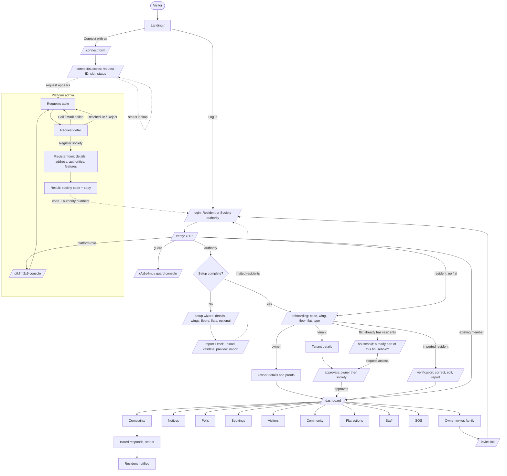

# Parisar: QA Master Testing Plan

**Date:** 10 November 2026.
**Build under test:** branch `feat/saas-onboarding` (local, uncommitted), web app and Supabase backend.
**Environment:** local developer laptop. There is no staging environment yet.

This plan is the entry point for testing. It explains what Parisar is, how it's built, who uses it, what to test and in which order. It also explains where each set of test cases lives and how to record results. Everything here is based on inspecting the actual code and running the app, not on the product brief.

## 1. Project overview

Parisar is a society-management platform for Indian housing societies. It has a public website, a resident and committee web app, a platform-admin console, a security-guard console and an Expo mobile app. The mobile app is outside this QA pass.

The core loop that must always work: **a resident files a complaint, a board member responds, the status updates, and the resident is notified.** Other modules cover:
- Notices, polls, amenity bookings and the facility calendar
- Community posts with moderation
- Flat actions (warnings, fines and notices; fines are recorded only, with no payments)
- Visitors at the gate, staff directory, SOS and the member directory
- The onboarding journey, from a society's first contact through setup, Excel import and resident verification

## 2. Existing application architecture

| Layer | Implementation |
|---|---|
| Web app | Next.js 15 App Router, JavaScript only, in `apps/web`. Server components check the session with `getUser()`. Middleware redirects signed-out users to `/login` |
| API | No separate API server. The web app calls Supabase directly: PostgREST tables (`/rest/v1/<table>`) and Postgres functions (`/rest/v1/rpc/<name>`), mostly `SECURITY DEFINER` RPCs with their own auth, role and society checks |
| Authorization | Row-level security on every public table, scoped by `current_society_id()` from the JWT. The JWT hook `inject_society_claims` adds the society and role |
| Auth | Phone OTP through Supabase Auth, using a dev stub with fixed code `123456` for 30 test numbers. Returning users can use a PIN via the `pin-login` edge function |
| Storage | Supabase Storage buckets for complaint photos and other attachments, plus the private `parisar-proofs` bucket for owner, tenant and staff documents |
| Background work | `push_outbox` plus edge functions `notification-fanout`, `push-fanout`, `booking-ack-fanout` and `flat-action-fanout`. **Not running locally**, so push notifications are not delivered in this environment |
| Shared packages | `packages/api-client` (RPC wrappers), `packages/i18n` (English, Hindi, Marathi), `packages/shared-types`, `packages/ui-tokens` |
| Database | 79 migrations in `supabase/migrations`; local database at version `20261106000092` |

## 3. Technology stack

- **Web:** Next.js 15.2, React 19.2, Tailwind 4, shadcn/base-ui, i18next.
- **Backend:** Supabase (Postgres 15, PostgREST, GoTrue, Storage, Realtime, Edge Functions).
- **Tests:** Vitest for the web (84 test files across web and packages) and `tests/isolation` for row-level security.
  - **Do not run `tests/isolation` against a database with real data:** its old helper deletes every society.
- **QA tooling used in this pass:**
  - Playwright for browser tests.
  - Node scripts in `docs/qa/scripts/api` for API tests.
  - autocannon for the local load baseline.
  - k6 scripts in `docs/qa/scripts/perf` for staging.

## 4. User roles

Roles are separate mechanisms, not one field:
- **Platform role:** admin, sales or staff.
- **Membership role:** member, board_member, co_secretary or secretary.
- **Society title:** chairman, secretary, treasurer or committee member. It maps onto a membership role.
- **Resident type:** owner, tenant or family member.
- **Authorities:** a phone list for each society.
- **Gate guards.**
- **Staff records:** these have no login.

The full mapping of the brief's 15 roles, with what each can log into, is in `PARISAR_ROLE_PERMISSION_TESTING.md`, sections 1 and 2. Plumber, electrician, cleaner and other staff are directory records only and cannot sign in.

## 5. Module inventory

| Module | Routes | Status in this build |
|---|---|---|
| Public website | `/`, `/connect`, `/connect/success`, `/enroll` | Implemented |
| Authentication | `/login`, `/verify`, PIN login | Implemented (dev OTP) |
| Platform admin console | `/c/k7m2x9` (admin), `/c/p4v8qd` (sales), `/c/t6r3wz` (staff) | Implemented |
| Society setup | `/setup`, `/society`, `/society-dashboard`, `/dashboard/code-rotation` | Implemented |
| Resident import and verification | `/import`, `/verification`, `/verification/admin` | Implemented |
| Resident onboarding | `/onboarding`, `/onboarding/status`, `/join/*`, `/household`, `/approvals`, `/invite/[token]`, `/residents/*` | Implemented |
| Dashboards | `/dashboard` (admin and resident variants), guard console `/c/g8s4muv` | Implemented |
| Complaints | `/complaints`, `/complaints/new`, `/complaints/[id]`, `/my-complaints` | Implemented |
| Notices, polls | `/notices`, `/notices/new`, `/notices/[id]`, `/polls` | Implemented (both list pages return HTTP 500: CORE-001 and CORE-002) |
| Bookings, facility calendar | `/bookings`, `/bookings/new`, `/facilities` | Implemented, feature-gated |
| Community | `/community`, `/community/new`, `/community/[id]`, `/community/moderation` | Implemented, feature-gated |
| Flat actions | `/flat-actions`, `/flat-actions/new`, `/flat-actions/[id]` | Implemented, feature-gated |
| Visitors, guard, SOS | `/visitors`, `/c/g8s4muv`, header SOS button | Implemented |
| Staff | `/staff`, `/staff/manage`, `/staff/manage/new`, `/staff/manage/[id]` | Implemented (records only, no staff login) |
| Directory, review queue, role transfer | `/dashboard/directory`, `/dashboard/review-queue`, `/dashboard/role-transfer` | Implemented |
| Settings and profile | `/settings/notifications`, `/settings/grievance-officer`, `/profile`, `/about` | Implemented |
| Vehicles, parking, maintenance billing, payments, accounting, events, vendors, documents, reports, deliveries, expected visitors, staff attendance | none | **Not Implemented**: listed in `HIDDEN_NAV_ITEMS` in `apps/web/lib/nav/sidebarNav.js` |

## 6. Complete screen inventory

The **Testing scope** column says whether a screen got its own browser test cases in this pass or only a route load check.

| # | Screen | Route | Testing scope |
|---|---|---|---|
| 1 | Landing page | `/` | Browser-executed (ONB-TC) |
| 2 | Connect With Us | `/connect` | Browser-executed |
| 3 | Request success and status | `/connect/success` | Browser-executed |
| 4 | Enroll redirect | `/enroll` | Browser-executed |
| 5 | Login | `/login` | Browser-executed |
| 6 | Verify OTP and PIN | `/verify` | Browser-executed |
| 7 | Public invite | `/invite/[token]` | Browser-executed |
| 8-17 | Admin console sections (overview, requests, request detail, reschedule, reject, register, result, societies, catalogue, people) | `/c/k7m2x9` | Cases ready (ADM-TC), Not Tested |
| 18 | Setup wizard (5 steps) | `/setup` | Cases ready (SET-TC), Not Tested |
| 19 | Excel import | `/import` | Cases ready (IMP-TC), Not Tested in browser; API tested |
| 20-21 | Verification (resident, admin) | `/verification`, `/verification/admin` | Cases ready (VER-TC) |
| 22-23 | Onboarding wizard and status | `/onboarding`, `/onboarding/status` | Cases ready (ONBD-TC) |
| 24 | Approvals | `/approvals` | Cases ready (APR-TC) |
| 25-26 | Household, invite acceptance | `/household`, `/join/invite/[token]` | Cases ready (HH-TC) |
| 27 | Residents lists | `/residents/[type]` | Cases ready (RES-TC) |
| 28-31 | Staff manage, new, detail, directory | `/staff/manage*`, `/staff` | Cases ready (STF-TC) |
| 32 | Home dashboard | `/dashboard` | Route smoke: **Fail** for an authority with no flat (CORE-003) |
| 33-35 | Society dashboard, society profile, code rotation | | Route smoke Pass |
| 36-39 | Complaints (list, new, detail, my complaints) | | Browser-executed end to end (CORE-TC-004 to 034) |
| 40-42 | Notices (list, new, detail) | | Route smoke: list **Fail** (HTTP 500) |
| 43 | Polls | `/polls` | Route smoke **Fail** (HTTP 500) |
| 44-46 | Bookings, new booking, facility calendar | | Route smoke Pass |
| 47-50 | Community (list, new, detail, moderation) | | Route smoke Pass |
| 51-53 | Flat actions (list, new, detail) | | Route smoke Pass (list) |
| 54-61 | Visitors, guard console, directory, review queue, role transfer, notification settings, grievance officer, profile | | Cases ready (section K), Not Tested in browser |

## 7. Navigation flow

## 8. Feature-wise test cases

See `PARISAR_SCREEN_BY_SCREEN_TEST_CASES.md`:
- Part 1: public website and authentication, executed.
- Part 2: core modules, executed.
- Part 3: all remaining screens, ready to run.

Feature classifications are in the release readiness report, section 3.

## 9. Field-wise validation

`PARISAR_FIELD_AND_BUTTON_VALIDATION.xlsx`, sheet **Fields**. Each row records the field, its type, whether it is mandatory, its rules and DB mapping, and its status. Rows for screens not executed in this pass are marked Not Tested.

## 10. Button-wise testing

The same workbook, sheet **Buttons**. Each row records the expected action, the API called and the status.

## 11. Next/Back navigation testing

The common checks C1 to C7 are at the top of Part 3 of the screen document. Run them on every screen: signed-out access, wrong role, refresh, back after save, three widths, offline save and keyboard use. Wizard-specific cases: SET-TC-08 and 09 (setup wizard) and ONBD-TC-08 and 09 (onboarding wizard).

## 12. CRUD testing

| Module | Create | Read | Update | Delete | Where |
|---|---|---|---|---|---|
| Complaints | Executed | Executed | Status responses executed | Not supported | CORE-TC-017 to 034 |
| Notices, polls, bookings, visitors, SOS | API executed | API executed | API executed | As supported | `PARISAR_API_DATABASE_TESTING.md` |
| Setup structure (wings, floors, flats) | API executed | API executed | API executed | Delete RPCs exist | API doc (area `setup`), SET-TC |
| Staff | Not Tested | Not Tested | Not Tested | Not Tested | STF-TC |
| Community, flat actions | Not Tested | Route smoke | Not Tested | Not Tested | Section K |

## 13. API testing

`PARISAR_API_DATABASE_TESTING.md` covers the API cases executed against the local API, with scripts in `docs/qa/scripts/api/`. Together with the role document, that is 208 executed cases: 205 passed and 3 failed.

## 14. Database testing

The same document covers row checks after each workflow, duplicate prevention, relationships and isolation.

## 15. Role and permission testing

`PARISAR_ROLE_PERMISSION_TESTING.md` contains the role-to-screen visibility matrix and a role-by-RPC matrix executed with a real session for each role.

## 16. Multi-society testing

There are two societies:
- **Society A:** QA Sunrise Heights.
- **Society B:** QA-T Lotus Society.

38 isolation checks passed: no table or RPC returned the other society's data. See the API document, area `iso`.

## 17. UI/UX testing

Per-screen UI checks (alignment, fonts, overflow, empty, loading, error and success states) are in Parts 1 and 2 of the screen document. Route smoke checked for horizontal overflow at 375 and 1280 px. Known UI bugs: CORE-008 to CORE-011 and ONB-001.

## 18. Responsive testing

Widths 375, 768 and 1280 px. Executed for the public website and the core routes. Common check C5 applies to the rest.

## 19. Security testing

`PARISAR_SECURITY_TESTING.md`. It includes **one release blocker:** the dev backdoors, SEC-002.

## 20. Performance testing

`PARISAR_PERFORMANCE_TESTING.md` contains the staging plan and k6 scripts for 100 to 5,000 users, plus a local baseline. **No capacity claim is made.**

## 21. Integration testing

| Integration | Status |
|---|---|
| Supabase Auth OTP (dev stub) | Executed |
| SMS provider (MSG91, Twilio or Firebase) | **Not Implemented**: provider not chosen |
| Push notifications (FCM through the fanout edge functions) | **Blocked locally**: outbox rows are created but no worker processes them (CORE-TC-034) |
| Realtime (complaint updates) | Executed: **Fail** for live status and new-complaint updates (CORE-005, CORE-006) |
| Storage uploads | Complaint photos executed; proofs Not Tested |
| Excel (exceljs) | API validation executed; browser upload Not Tested in this pass |
| Email | Not Implemented |

## 22. Negative testing

Negative cases are part of each module's test cases:
- Invalid input, duplicates, double submit and wrong role in the screen and API documents.
- Common checks C1 to C7.
- The security checks still to run (XSS, SQL injection, CSRF), listed in the security document, section 7.

## 23. Regression testing

Run before every release:

1. `apps/web`: `npx vitest run`. The baseline for this branch is 876 passed and 5 failing (pre-existing, `admin-screens-03-10`).
2. `packages/api-client`: `npx vitest run` (345 passed).
3. `node scripts/check-i18n-coverage.mjs`.
4. `next build`.
5. The API scripts in `docs/qa/scripts/api`, against a **fresh** database seeded only with test data.
6. The core loop: CORE-TC-022 to 029.

## 24. Bug tracking

Bugs are recorded in `PARISAR_BUG_TRACKER.xlsx`, using the Part 13 format with severity, priority and status dropdowns. When reporting a bug, add a row with the next ID for its area (`ONB`, `CORE`, `API`, `ROLE`, `SEC` or `PERF`), steps, expected and actual results, and evidence. Set the status to Retest after a fix and Closed after it passes.

## 25. Release readiness

See `PARISAR_RELEASE_READINESS_REPORT.md`.

## How to run a test session

1. Start the backend: `supabase start`. Never run `supabase db reset` on a database you care about.
2. Back up the database first: `docker exec supabase_db_parisar pg_dump -U postgres -d postgres -Fc > ~/parisar-backups/<date>.dump`.
3. Start the web app: `cd apps/web && npx next dev`.
4. Sign in with the test numbers listed in Part 3 of the screen document, using OTP `123456`.
5. Execute the cases, saving screenshots to `docs/qa/evidence/<area>/`. Update the status in the markdown and the bug tracker.
